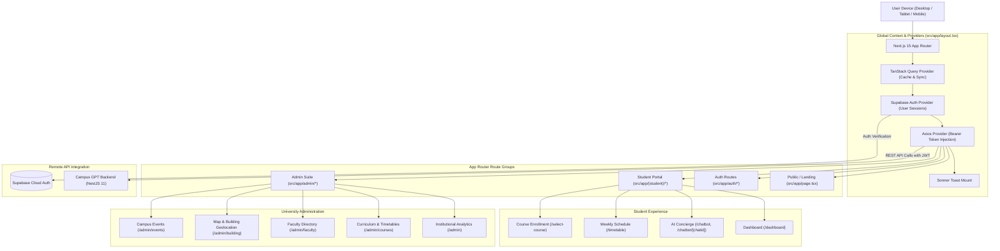

# Campus GPT — Next.js 15 Academic Portal & AI Concierge UI

[](https://nextjs.org/)
[](https://react.dev/)
[](https://www.typescriptlang.org/)
[](https://tailwindcss.com/)
[](https://tanstack.com/query/latest)
[](https://supabase.com/docs/guides/auth)
[](https://vercel.com/)

Campus GPT Frontend is the next-generation academic portal and student companion interface for university campuses. Built with **Next.js 15 (App Router)**, **React 19**, **Tailwind CSS v4**, and **TanStack Query v5**, it provides an intuitive, high-performance UI for interacting with campus AI assistants, managing academic schedules, navigating university facilities, and administering institutional curriculums.

---

## 1. System Architecture Overview

The frontend follows Next.js 15 App Router architecture with clear route segregation between public marketing, authenticated student workspaces, and university administration suites.



---

## 2. Complete Routes & Pages Catalog

| Route | Access Level | Description | Key Components & API Calls |
| :--- | :--- | :--- | :--- |
| `/` | Public | Institutional landing page and feature highlights | Hero section, login CTA, feature carousels |
| `/auth/login` | Public | Student and Administrator login with credentials or Google OAuth | `supabase.auth.signInWithPassword`, Google OAuth |
| `/auth/signup` | Public | Student self-registration (streamlined direct-to-dashboard UX) | `supabase.auth.signUp`, automatic redirect to `/dashboard` |
| `/login` | Public | Permanent 308 redirect to `/auth/login` | Configured in `next.config.ts` |
| `/dashboard` | Student | Personal academic dashboard (today's schedule, enrolled degree, events) | `fetchStudentCourse`, `fetchStudentTodaySchedule`, `fetchUpcomingEvents` |
| `/timetable` | Student | Full interactive weekly class schedule with room & faculty badges | `fetchCourseTimeTable` grouped by day of week |
| `/select-course` | Student | Course selection and degree program enrollment view | `fetchAllCourses`, `joinCourse` mutation |
| `/chatbot` | Student | AI Assistant landing: Start new conversation or select recent thread | `fetchChatRooms`, `createNewChat` mutation |
| `/chatbot/[chatid]` | Student | Conversational AI workspace with streaming feel, markdown & auto-scroll | `fetchChatMessages`, `sendMessage` with optimistic updates |
| `/admin` | Admin | Real-time university operational KPIs and recent student enrollments | `fetchAdminDashboardData` (counts for students, faculty, courses, buildings) |
| `/admin/courses` | Admin | Degree programs catalog and curriculum management | `fetchAllCourses`, `createCourse`, `deleteCourse` |
| `/admin/courses/[courseId]` | Admin | Subjects and batch timetable scheduler for a specific course | `fetchCourseSubjects`, `createSubject`, `createCompleteTimeTable` |
| `/admin/faculty` | Admin | University professor directory, cabin locations, and contact records | `fetchAllFaculty`, `createFaculty`, `updateFaculty` |
| `/admin/building` | Admin | Campus facilities directory with Google Maps coordinate picker | `fetchAllBuildings`, `createBuilding`, `MapSelector`, `LocationManager` |
| `/admin/events` | Admin | Campus activities, academic seminars, and cultural event publisher | `fetchEvents`, `createEvent`, `deleteEvent` |

---

## 3. Technology Stack & Design Decisions

### 3.1 Next.js 15 (App Router with Turbopack)
- Nested layouts (`src/app/(student)/layout.tsx`, `src/app/admin/layout.tsx`) keep navigational bars persistent while pages swap seamlessly.
- Sub-second local builds and hot-module replacement via Turbopack.

### 3.2 React 19 & Concurrent State Management
- Takes advantage of modern concurrent rendering, transitions, and automatic batching for fluid UI updates.

### 3.3 Tailwind CSS v4 & Modern Token System
- Full CSS-first styling powered by Tailwind v4.
- Resolves dark mode theming and high-contrast metric card gradients (`text-white font-extrabold`).

### 3.4 Headless UI: Radix UI & shadcn/ui
- Fully accessible dialogs, alerts, selects, buttons, and scroll areas with full keyboard navigation and ARIA compliance.

### 3.5 Server-State Caching: TanStack Query v5
- Eliminates manual loading spinners and error handling via declarative queries (`isPending`, `isError`, `data`).
- Automatic background refetching and surgical cache invalidation (`queryClient.invalidateQueries`).

### 3.6 Authentication: Supabase Auth
- Secure JWT-based session management.
- Transparent token renewal and session propagation into Axios request headers.

---

## 4. Environment Variables Configuration

Create a `.env.local` file in the `frontend/` directory:

```bash
# Supabase Project Configuration
NEXT_PUBLIC_SUPABASE_URL=https://<your-project-ref>.supabase.co
NEXT_PUBLIC_SUPABASE_ANON_KEY=eyJhbGciOiJIUzI1NiIsInR5cCI6IkpXVCJ9...

# Backend API Endpoint
# Local Development: http://localhost:4000
# Production: https://campus-gpt-backend.vercel.app
NEXT_PUBLIC_API_URL=https://campus-gpt-backend.vercel.app

# Optional OAuth Redirect URL
NEXT_PUBLIC_DEV_SUPABASE_REDIRECT_URL=http://localhost:3000/auth/callback
```

---

## 5. Local Setup & Execution Guide

### Prerequisites
- Node.js 20.x or 22.x LTS
- Yarn 1.22+ or npm 10+
- Running instance of the `campus-gpt-backend` API

### Installation
```bash
# Clone and enter directory
cd frontend

# Install dependencies
yarn install
```

### Running Locally
```bash
# Start development server with Turbopack
yarn dev

# Compile production build
yarn build

# Run production build locally
yarn start

# Run ESLint validation
yarn lint
```

The application will be accessible at [http://localhost:3000](http://localhost:3000).

---

## 6. Production Vercel Deployment

The frontend is optimized for zero-configuration deployment on **Vercel**:

```bash
# Build the project to verify Turbopack and ESLint
yarn build

# Deploy via Vercel CLI
vercel --prod
```

### Build Settings on Vercel Dashboard
- **Framework Preset**: Next.js
- **Root Directory**: `frontend` (or repository root if deployed from standalone repo)
- **Build Command**: `next build --turbopack`
- **Output Directory**: `.next`
- **Environment Variables**: Add `NEXT_PUBLIC_SUPABASE_URL`, `NEXT_PUBLIC_SUPABASE_ANON_KEY`, and `NEXT_PUBLIC_API_URL`.

---

## 7. Directory Structure

```text
frontend/
├── src/
│   ├── app/
│   │   ├── (student)/                   # Student workspace route group
│   │   │   ├── chatbot/                 # AI Assistant conversation thread views
│   │   │   ├── dashboard/               # Today's agenda, courses, upcoming events
│   │   │   ├── select-course/           # Program enrollment selector
│   │   │   ├── timetable/               # Interactive weekly timetable
│   │   │   └── layout.tsx               # Student layout with tab-focus persistence
│   │   ├── admin/                       # University administrative workspace
│   │   │   ├── building/                # Facility coordinates & map picker
│   │   │   ├── courses/                 # Degrees, subjects & timetable builder
│   │   │   ├── events/                  # Campus activity publisher
│   │   │   ├── faculty/                 # Professor office directory
│   │   │   ├── layout.tsx               # Admin layout & role guard
│   │   │   └── page.tsx                 # Administrative KPI dashboard
│   │   ├── api/                         # Edge Next.js API routes (callbacks/sessions)
│   │   ├── auth/                        # Authentication views (Login & Signup)
│   │   ├── globals.css                  # Tailwind CSS v4 variables & theme tokens
│   │   ├── layout.tsx                   # Root HTML shell & provider cascade
│   │   └── page.tsx                     # Public landing page
│   ├── components/
│   │   └── ui/                          # shadcn/ui & Radix UI accessible primitives
│   ├── lib/
│   │   ├── chat-storage.ts              # Local conversation cache utilities
│   │   ├── mock-data.ts                 # Fallback offline development fixtures
│   │   ├── supabse.ts                   # Supabase client instantiation
│   │   └── utils.ts                     # ClassName merger (cn)
│   ├── providers/
│   │   ├── supabse.provider.tsx         # Supabase auth session listener
│   │   └── tanstack.provider.tsx        # React Query cache configuration
│   ├── services/
│   │   └── axios/                       # Centralized Axios provider & Bearer interceptor
│   └── types/
│       └── global.types.ts              # Domain entities (Course, Faculty, Timetable)
├── decission.md                         # Architecture Decision Records (ADRs)
├── flowchart.md                         # Detailed component & data flowcharts
├── next.config.ts                       # Next.js runtime configuration & route redirects
├── package.json                         # Dependencies & build scripts
└── tsconfig.json                        # TypeScript configuration
```

---

## 8. Project Creators & Team Attribution

Campus GPT is developed by:
- **Ajay**
- **Muskan**
- **Madhav**
- **Aayush**
- **Prince**
