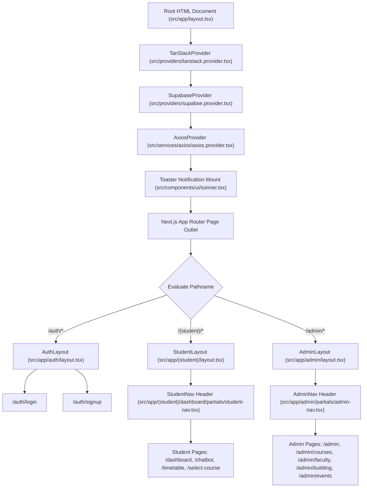
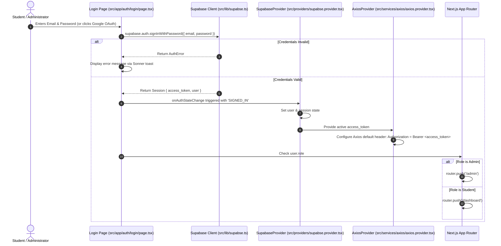
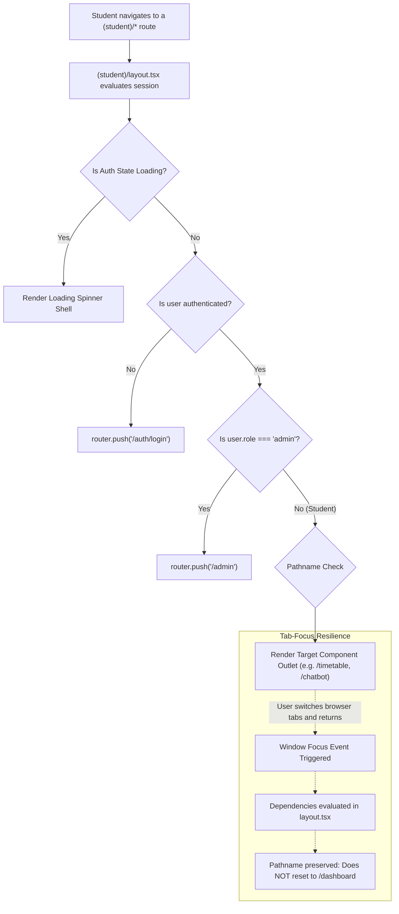
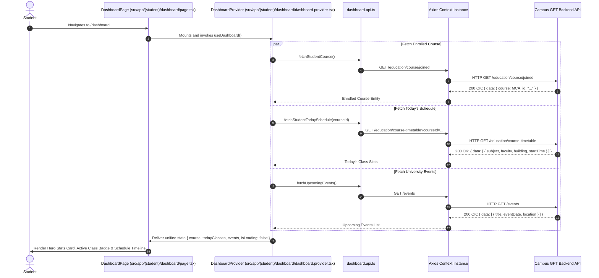
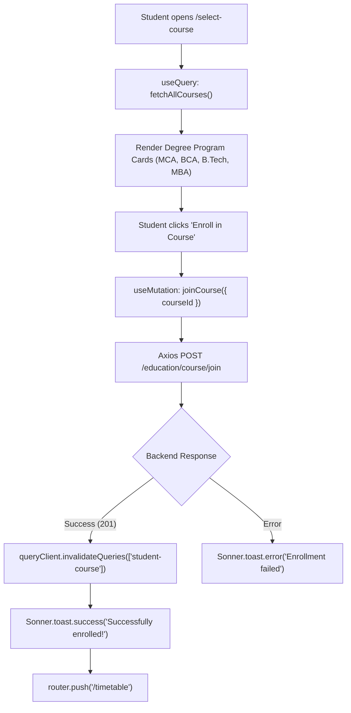
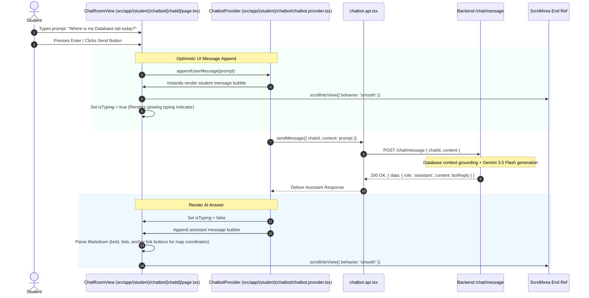
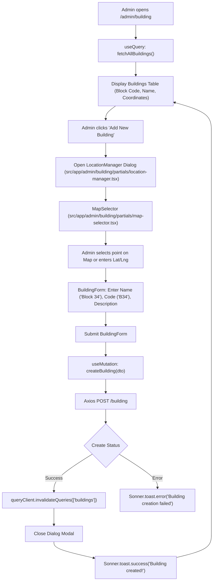
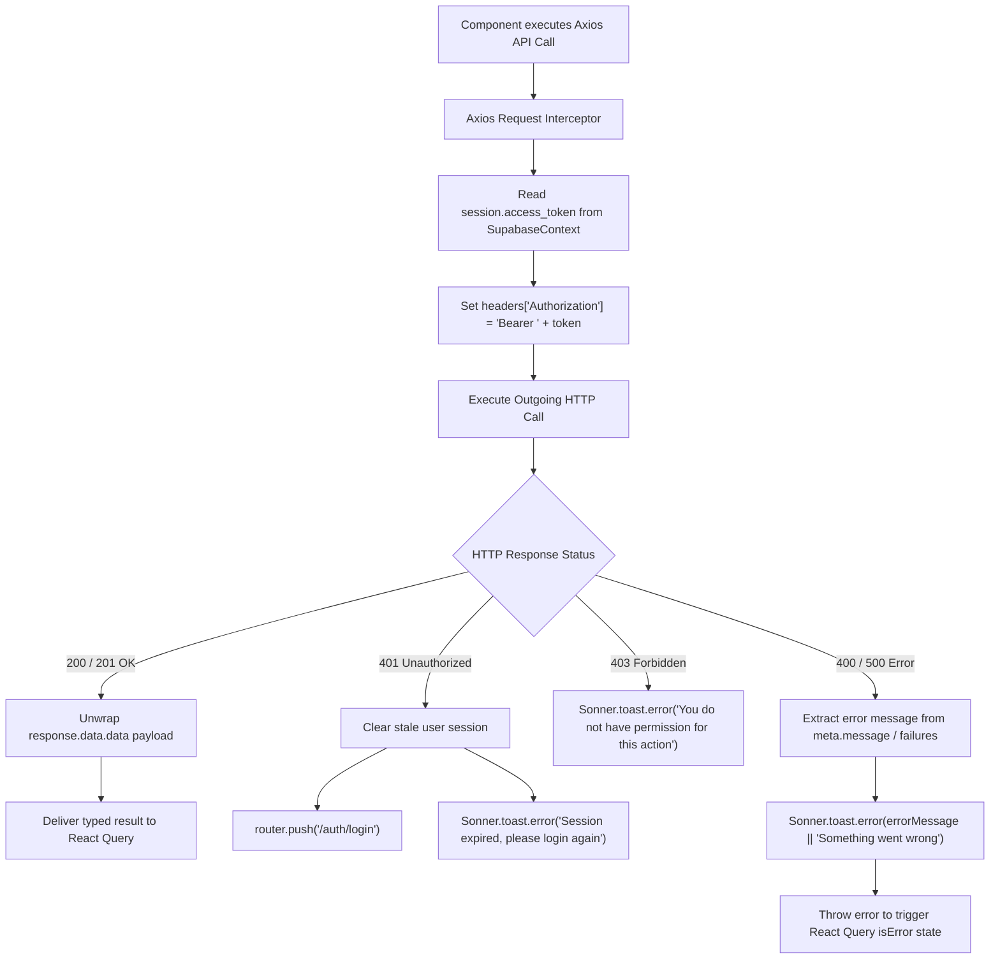

# Campus GPT Frontend — Component Hierarchy & Execution Flowcharts

This document details the complete component hierarchy, client-side routing trees, execution flowcharts, and asynchronous state lifecycles for the **Campus GPT Frontend**. It traces data and event execution across Next.js 15 App Router layouts, React 19 Client Components, TanStack Query caches, and Supabase Authentication listeners.

---

## 1. Global Application Hierarchy & Root Provider Pipeline

Every page rendered in Campus GPT is encapsulated by a cascaded hierarchy of context providers defined in `src/app/layout.tsx`.

---

## 2. Authentication & Session Initialization Lifecycle

The authentication lifecycle handles credential validation, token propagation into HTTP interceptors, and automated role-based navigation.

---

## 3. Student Route Guard & Focus Persistence Flow

The student layout enforces authentication while preserving the student's active route across window focus events.

---

## 4. Student Dashboard & Timetable Data Fetching Flow

The student dashboard orchestrates multiple parallel server-state queries via TanStack Query to construct the student's day agenda.

---

## 5. Course Enrollment Lifecycle (`/select-course`)

When a new student joins the platform, they must pick their degree program before accessing customized timetables.

---

## 6. AI Concierge Conversational Pipeline (`/chatbot/[chatid]`)

The chatbot UI delivers a real-time conversational feed with optimistic updates, animated loading indicators, and markdown formatting.

---

## 7. Campus Building & Location Management Flow (`/admin/building`)

Administrators configure physical campus blocks with coordinates and navigation directions.

---

## 8. Global HTTP Interceptor & Error Handling Flow

